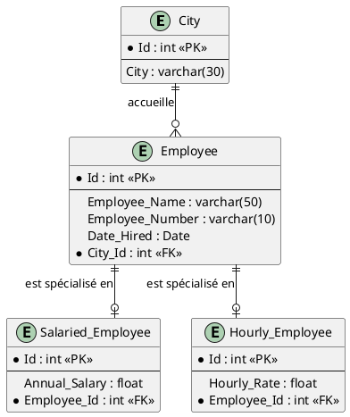

# SEG2505 – Introduction au Génie Logiciel
## Rapport de Laboratoire 6 : SQLite et Android

**Nom de l'étudiant :** Adam Achaba  
**Dépôt GitHub :** https://github.com/AdamAchaba/SEG2505_Lab6_SQLite  

---

## 1. Exercice RDBMS (Diapositive 8 - "A rendre")

### Question 1 : Identifier les tables, les champs, les clés primaires (PK) et les clés étrangères (FK)

| Table | Attribut (Champ) | Type SQL | Rôle / Contrainte |
| :--- | :--- | :--- | :--- |
| **City** | `Id` | `int` | **Clé primaire (PK)** |
| | `City` | `varchar(30)` | Attribut descriptif (nom de la localité) |
| **Employee** | `Id` | `int` | **Clé primaire (PK)** |
| | `Employee_Name` | `varchar(50)` | Attribut (nom de l'employé) |
| | `Employee_Number` | `varchar(10)` | Attribut (identifiant matricule) |
| | `Date_Hired` | `Date` | Attribut (date d'embauche) |
| | `City_Id` | `int` | **Clé étrangère (FK)** $\rightarrow$ référence `City(Id)` |
| **Salaried_Employee** | `Id` | `int` | **Clé primaire (PK)** |
| | `Annual_Salary` | `float` | Attribut (salaire fixe annuel) |
| | `Employee_Id` | `int` | **Clé étrangère (FK)** $\rightarrow$ référence `Employee(Id)` |
| **Hourly_Employee** | `Id` | `int` | **Clé primaire (PK)** |
| | `Hourly_Rate` | `float` | Attribut (taux horaire) |
| | `Employee_Id` | `int` | **Clé étrangère (FK)** $\rightarrow$ référence `Employee(Id)` |

---

### Question 2 : Sémantique des relations représentées

1. **Relation `City` $\leftrightarrow$ `Employee` (Association plusieurs-à-un / $1 \dots N$) :**
   - Chaque employé est localisé dans une et une seule ville (`City_Id` est une clé étrangère pointant vers `City.Id`).
   - Une ville peut accueillir aucun, un seul ou plusieurs employés.

2. **Relations d'héritage / spécialisation (`Employee` $\rightarrow$ `Salaried_Employee` et `Hourly_Employee`) :**
   - Cette modélisation applique le patron de conception relationnel *Class Table Inheritance* :
     - La table générale `Employee` rassemble tous les attributs partagés par l'ensemble des employés.
     - La table spécialisée `Salaried_Employee` conserve exclusivement les attributs des employés rémunérés sur une base annuelle (`Annual_Salary`).
     - La table spécialisée `Hourly_Employee` conserve exclusivement les attributs des employés rémunérés à l'heure (`Hourly_Rate`).
   - L'attribut `Employee_Id` dans chaque sous-table assure le lien strict 1:1 vers la table mère `Employee`.

---

### Question 3 : Enregistrements démontrant les relations du modèle

#### Table `City`
| Id (PK) | City |
| :---: | :--- |
| **1** | Ottawa |
| **2** | Gatineau |

#### Table `Employee`
| Id (PK) | Employee_Name | Employee_Number | Date_Hired | City_Id (FK) |
| :---: | :--- | :--- | :---: | :---: |
| **101** | Alice Dupont | EMP-001 | 2024-01-15 | **1** |
| **102** | Bob Tremblay | EMP-002 | 2024-03-01 | **2** |
| **103** | Claire Martin | EMP-003 | 2024-05-20 | **1** |

#### Table `Salaried_Employee`
| Id (PK) | Annual_Salary | Employee_Id (FK) |
| :---: | :---: | :---: |
| **1** | 85000.00 | **101** *(Alice Dupont, Ottawa)* |
| **2** | 92000.00 | **103** *(Claire Martin, Ottawa)* |

#### Table `Hourly_Employee`
| Id (PK) | Hourly_Rate | Employee_Id (FK) |
| :---: | :---: | :---: |
| **1** | 25.50 | **102** *(Bob Tremblay, Gatineau)* |

---

### Fichier PlantUML du diagramme ERD (Exigence Slide 3)

---

## 2. Passage à la pratique : Android & SQLite (Diapositive 51 - "A rendre")

### A. Implémentation du tutoriel "Enregistrer des données avec SQLite"
- **Contrat de base de données :** `FeedReaderContract.java` définissant `FeedEntry` (table `entry`, colonnes `title` et `subtitle`).
- **Gestionnaire SQLite :** `FeedReaderDbHelper.java` implémentant les méthodes complètes du cycle CRUD :
  - `insertEntry(title, subtitle)` via `SQLiteDatabase.insert()`
  - `getAllEntries()` via `SQLiteDatabase.query()` avec projection et tri
  - `deleteEntry(title)` via `SQLiteDatabase.delete()`
  - `updateEntry(...)` via `SQLiteDatabase.update()`
- **Interface interactive :** `MainActivity.java` et `activity_main.xml` permettant d'ajouter, lire et supprimer des enregistrements en temps réel.

### B. Captures d'écran pour le document Word (Exigence Slide 3)

#### Capture 1 : Insertion d'une entrée dans SQLite
*« J'ai testé l'insertion d'un nouvel enregistrement dans la base de données SQLite via le bouton AJOUTER et la méthode insertEntry(). »*  
*(Insérer la capture d'écran montrant l'entrée ajoutée et affichée dans la liste)*

#### Capture 2 : Lecture et affichage des données
*« J'ai validé la lecture de tous les enregistrements depuis la table SQLite avec la méthode getAllEntries() et l'affichage dans la zone de texte. »*  
*(Insérer la capture d'écran montrant le contenu de la base de données)*

#### Capture 3 : Suppression d'une entrée
*« J'ai testé la suppression d'une entrée spécifique via le titre avec la méthode deleteEntry(). »*  
*(Insérer la capture d'écran montrant la mise à jour immédiate après suppression)*

#### Capture 4 : Tests d'instrumentation et débogage (`FeedReaderDbTest`)
*« J'ai exécuté la suite de tests JUnit instrumentés FeedReaderDbTest validant de manière automatisée l'insertion, la recherche et la suppression selon le tutoriel Android Developers. »*  
*(Insérer la capture d'écran de l'onglet Run / Android JUnit avec tous les tests validés en vert)*
