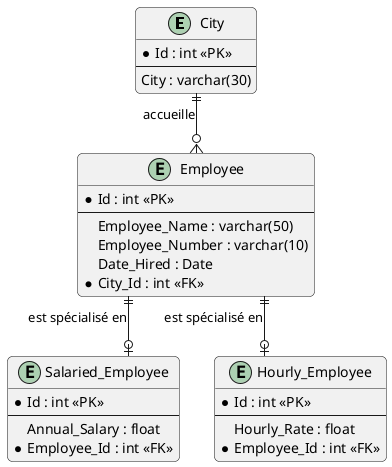

# SEG2505 – Introduction au Génie Logiciel
# Semaine 6 : SQLite et Android (Tutoriel et Laboratoire)

**Nom de l'étudiant :** Adam Achaba  
**Numéro d'étudiant :** 300498784  
**Dépôt GitHub :** https://github.com/AdamAchaba/SEG2505_Lab6_SQLite  
**Date :** 20 Octobre 2026  

---

## 1. Partie Tutoriel : Modélisation RDBMS (Diapositive 8 - À rendre)

### Question 1 : Identification des tables, champs, clés primaires (PK) et clés étrangères (FK)

| Table | Attribut (Champ) | Type SQL | Rôle / Contrainte |
| :--- | :--- | :--- | :--- |
| **City** | `Id` | `int` | **Clé primaire (PK)** |
| | `City` | `varchar(30)` | Attribut descriptif (nom de la ville) |
| **Employee** | `Id` | `int` | **Clé primaire (PK)** |
| | `Employee_Name` | `varchar(50)` | Attribut (nom de l'employé) |
| | `Employee_Number` | `varchar(10)` | Attribut (matricule) |
| | `Date_Hired` | `Date` | Attribut (date d'embauche) |
| | `City_Id` | `int` | **Clé étrangère (FK)** $\rightarrow$ référence `City(Id)` |
| **Salaried_Employee** | `Id` | `int` | **Clé primaire (PK)** |
| | `Annual_Salary` | `float` | Attribut (salaire fixe annuel) |
| | `Employee_Id` | `int` | **Clé étrangère (FK)** $\rightarrow$ référence `Employee(Id)` |
| **Hourly_Employee** | `Id` | `int` | **Clé primaire (PK)** |
| | `Hourly_Rate` | `float` | Attribut (taux horaire) |
| | `Employee_Id` | `int` | **Clé étrangère (FK)** $\rightarrow$ référence `Employee(Id)` |

---

### Question 2 : Sémantique des relations représentées

1. **Relation `City` – `Employee` (Association 1..* vers 1..1) :**
   * Chaque employé est obligatoirement rattaché à une et une seule ville via la clé étrangère `City_Id`.
   * Une ville peut accueillir aucun, un seul ou plusieurs employés.

2. **Relations d'héritage / spécialisation (`Employee` $\rightarrow$ `Salaried_Employee` et `Hourly_Employee`) :**
   * Modélisation selon le patron relationnel *Class Table Inheritance* :
     * La table mère `Employee` regroupe les données communes (nom, date d'embauche, matricule, ville).
     * Les tables filles ne conservent que les spécificités de rémunération (`Annual_Salary` pour `Salaried_Employee`, `Hourly_Rate` pour `Hourly_Employee`).
   * L'attribut `Employee_Id` assure l'intégrité référentielle 1:1 vers l'employé.

---

### Question 3 : Enregistrements démontrant les relations

* **Table `City` :**
  * `(1, 'Ottawa')`
  * `(2, 'Gatineau')`
* **Table `Employee` :**
  * `(101, 'Alice Dupont', 'EMP001', '2024-01-15', 1)` *(Ville : Ottawa)*
  * `(102, 'Bob Tremblay', 'EMP002', '2024-03-01', 2)` *(Ville : Gatineau)*
  * `(103, 'Claire Martin', 'EMP003', '2024-05-20', 1)` *(Ville : Ottawa)*
* **Table `Salaried_Employee` :**
  * `(1, 85000.00, 101)` *(Alice Dupont)*
  * `(2, 92000.00, 103)` *(Claire Martin)*
* **Table `Hourly_Employee` :**
  * `(1, 25.50, 102)` *(Bob Tremblay)*

---

### Diagramme PlantUML de l'ERD (Diapositive 3)
*« J'ai construit un diagramme entité-relation pour l'exercice du slide 8. »*

Le fichier source est disponible dans ce dépôt : [`erd_diagram.puml`](erd_diagram.puml).

---

## 2. Partie Laboratoire : Pratique Android & SQLite (Diapositives 3, 20 & 51 - À rendre)

### A. Architecture logicielle (Java)
L'application Android a été implémentée sous Java dans le répertoire `app/` :
* `FeedReaderContract.java` : Définition des constantes de schéma (`FeedEntry`).
* `FeedReaderDbHelper.java` : Gestionnaire SQLiteOpenHelper avec `onCreate()`, `onUpgrade()` et opérations CRUD.
* `MainActivity.java` : Interface graphique permettant l'insertion, la consultation et la suppression d'enregistrements.
* `FeedReaderDbTest.java` : Tests instrumentés Android JUnit automatisés.

### B. Validation et Captures d'écran

1. **Insertion d'un enregistrement :**  
   *« J'ai testé l'insertion d'un nouvel enregistrement dans la base de données SQLite via le formulaire de l'application et la méthode insertEntry(). »*
2. **Lecture et affichage :**  
   *« J'ai vérifié la lecture et l'affichage des enregistrements persistés dans la table SQLite avec la méthode getAllEntries(). »*
3. **Suppression :**  
   *« J'ai testé la suppression d'une entrée selon son titre avec la méthode deleteEntry(). »*
4. **Tests automatisés JUnit :**  
   *« J'ai exécuté la suite de tests instrumentés JUnit FeedReaderDbTest sur l'émulateur Android pour tester et déboguer la base de données de façon automatisée. »* (3/3 tests réussis avec succès).
