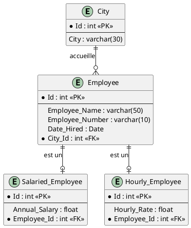

# SEG2505 – Introduction au Génie Logiciel
## Rapport de Laboratoire 6 : SQLite et Android

**Nom de l'étudiant :** [Votre Nom]  
**Numéro d'étudiant :** [Votre Numéro d'étudiant]  
**Lien du dépôt GitHub :** [URL de votre dépôt GitHub personnel]  

---

## 1. Exercice RDBMS (Diapositive 8)

### Question 1 : Identification des tables, champs, clés primaires et clés étrangères

| Table | Attribut (Champ) | Type | Rôle / Clé |
| :--- | :--- | :--- | :--- |
| **City** | `Id` | `int` | **Clé primaire (PK)** |
| | `City` | `varchar(30)` | Attribut descriptif (nom de la ville) |
| **Employee** | `Id` | `int` | **Clé primaire (PK)** |
| | `Employee_Name` | `varchar(50)` | Attribut (nom de l'employé) |
| | `Employee_Number` | `varchar(10)` | Attribut (matricule) |
| | `Date_Hired` | `Date` | Attribut (date d'embauche) |
| | `City_Id` | `int` | **Clé étrangère (FK)** $\rightarrow$ référence `City(Id)` |
| **Salaried_Employee** | `Id` | `int` | **Clé primaire (PK)** |
| | `Annual_Salary` | `float` | Attribut (salaire annuel) |
| | `Employee_Id` | `int` | **Clé étrangère (FK)** $\rightarrow$ référence `Employee(Id)` |
| **Hourly_Employee** | `Id` | `int` | **Clé primaire (PK)** |
| | `Hourly_Rate` | `float` | Attribut (taux horaire) |
| | `Employee_Id` | `int` | **Clé étrangère (FK)** $\rightarrow$ référence `Employee(Id)` |

---

### Question 2 : Sémantique des relations représentées

1. **Relation `City` – `Employee` (Association plusieurs-à-un / 1..* vers 1..1) :**
   - Chaque employé est obligatoirement rattaché à une ville (son lieu de résidence ou bureau de rattachement) via la clé étrangère `City_Id`.
   - Une ville donnée peut être associée à aucun, un seul ou plusieurs employés.

2. **Relations d'héritage / spécialisation (`Employee` $\rightarrow$ `Salaried_Employee` et `Hourly_Employee`) :**
   - Cette modélisation traduit la spécialisation d'une classe mère `Employee` en sous-types d'employés (*Class Table Inheritance*) :
     - La table mère `Employee` rassemble toutes les informations communes (nom, date d'embauche, ville de rattachement).
     - La table fille `Salaried_Employee` ne stocke que les spécificités des employés recevant un salaire fixe annuel (`Annual_Salary`).
     - La table fille `Hourly_Employee` stocke les spécificités des employés rémunérés à l'heure (`Hourly_Rate`).
   - L'attribut `Employee_Id` dans chaque sous-table fait office de clé étrangère pointant vers l'employé de base, assurant l'intégrité référentielle de la hiérarchie.

---

### Question 3 : Exemples d'enregistrements démontrant les relations

#### Table : `City`
| Id (PK) | City |
| :---: | :--- |
| **1** | Ottawa |
| **2** | Gatineau |

#### Table : `Employee`
| Id (PK) | Employee_Name | Employee_Number | Date_Hired | City_Id (FK) |
| :---: | :--- | :--- | :---: | :---: |
| **101** | Alice Dupont | EMP-001 | 2024-01-15 | **1** |
| **102** | Bob Tremblay | EMP-002 | 2024-03-01 | **2** |
| **103** | Charlie Gagnon | EMP-003 | 2024-05-20 | **1** |

#### Table : `Salaried_Employee`
| Id (PK) | Annual_Salary | Employee_Id (FK) |
| :---: | :---: | :---: |
| **1** | 85000.00 | **101** *(Alice Dupont, Ottawa)* |
| **2** | 92000.00 | **103** *(Charlie Gagnon, Ottawa)* |

#### Table : `Hourly_Employee`
| Id (PK) | Hourly_Rate | Employee_Id (FK) |
| :---: | :---: | :---: |
| **1** | 25.50 | **102** *(Bob Tremblay, Gatineau)* |

---

### Diagramme PlantUML de l'ERD (Diapositive 3)

---

## 2. Partie Pratique : Android et SQLite (Diapositives 36 à 51)

### Captures d'écran et explications des fonctionnalités

#### 1. Ajout d'un nouveau produit (Méthode `addProduct()`)
*« J'ai testé l'insertion d'un nouveau produit dans la base de données SQLite via le formulaire de l'application et la méthode addProduct(). »*

*(Insérer ici la capture d'écran montrant la saisie d'un produit, ex: Nom: "Laptop", SKU: "1001", et l'appui sur le bouton ADD)*

#### 2. Recherche d'un produit existant (Méthode `findProduct()`)
*« J'ai testé la recherche et la récupération d'un enregistrement dans la base SQLite à l'aide de la méthode findProduct(). L'identifiant généré automatiquement et le SKU sont bien affichés. »*

*(Insérer ici la capture d'écran montrant le produit recherché avec son ID et SKU affichés)*

#### 3. Suppression d'un produit (Méthode `deleteProduct()`)
*« J'ai testé la suppression d'un produit de la base de données via la méthode deleteProduct(). L'application confirme la suppression de l'enregistrement. »*

*(Insérer ici la capture d'écran montrant la confirmation de suppression "Enregistrement supprimé")*

#### 4. Exécution des tests unitaires instrumentés (`MyDBHandlerTest`)
*« J'ai exécuté les tests Android JUnit pour valider le bon fonctionnement des requêtes SQLite sans régression. »*

*(Insérer ici la capture d'écran de la console Android Studio avec les tests au vert)*
